## {background-color="#3D3F8F" .oscura .portada}

::: {.columns}
::: {.column width="58%"}
<br>

# GeneExprLupusMx

#### Datos transcriptómicos de mujeres mexicanas con lupus, un paquete de R y una Shiny app para aprender, explorar y reutilizar

[📦 Paquete](https://eveliacoss.github.io/GeneExprLupusMx/){.boton .blanco} [✨ Shiny app](https://eveliacossnav.shinyapps.io/GeneExprLupusMx_shinyapp/){.boton .blanco}

<br><br><br><br>

**Evelia Coss** · [eveliacoss.github.io](https://eveliacoss.github.io/)
:::

::: {.column width="42%"}
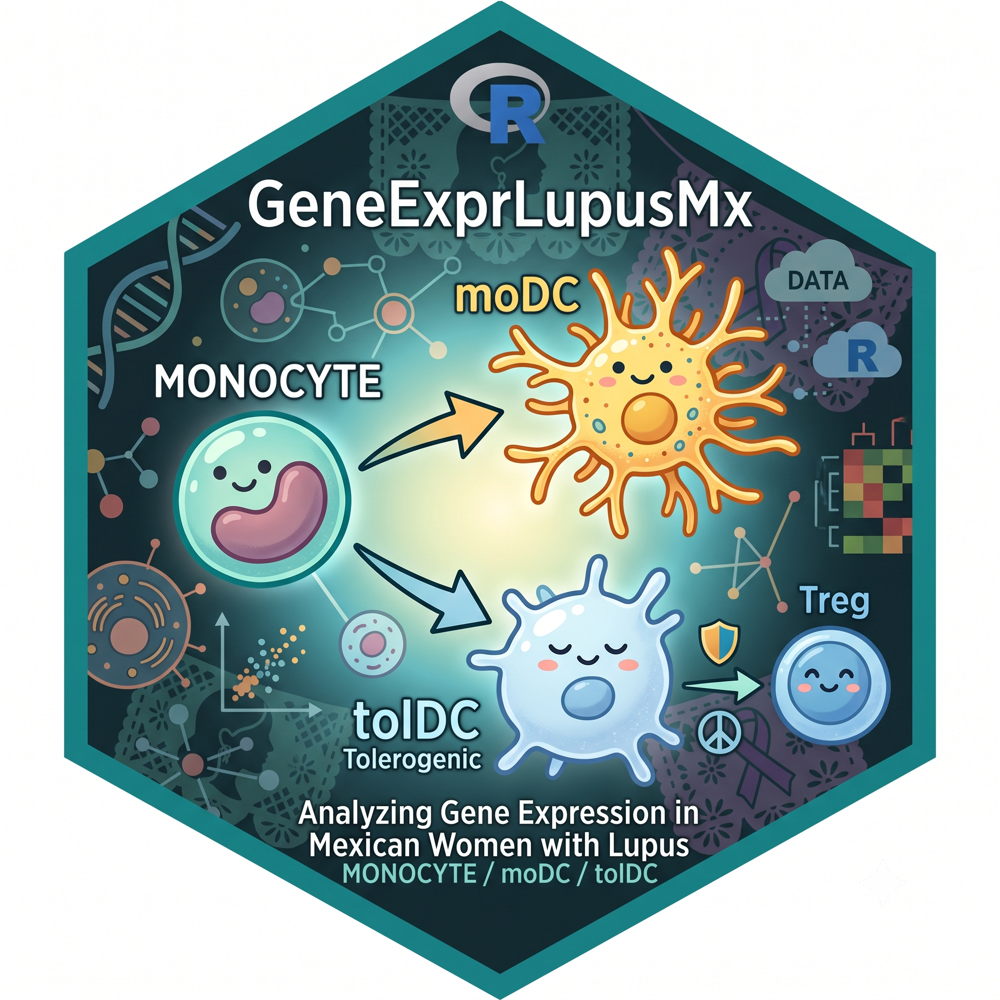{fig-alt="Logo hexagonal de GeneExprLupusMx: un monocito que se diferencia en moDC y tolDC" width="100%"}
:::
:::

::: {.pequeno .fuente .izq}
LatinR 2026 · 11 al 13 Nov 2026 · Universidad de Antioquia, Medellín 🇨🇴
:::

::: {.ropensci}
[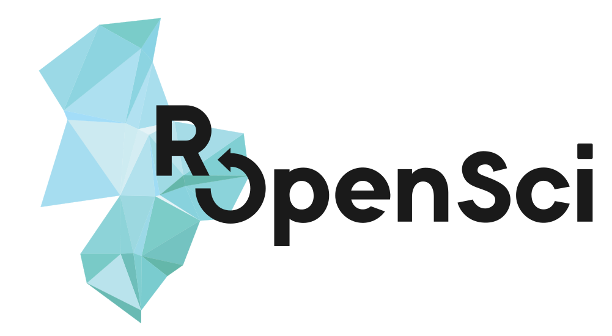{fig-alt="Logo de rOpenSci"}](https://ropensci.org/)

[Champions<br>Program](https://ropensci.org/champions/)
:::

::: {.notes}
(0:30) ¡Hola, LatinR! Hoy les traigo un paquete de datos y una app que nacieron de una pregunta: ¿cómo aprendemos bioinformática con datos de nuestra región?
:::

## ¿Transcriptomas públicos para aprender? 🔍 {.centrado}

::: {.columns}
::: {.column width="25%"}
::: {.cifra}
[230]{.n}
[paquetes de **datos** de<br>transcriptómica en Bioconductor]{.t}
:::
:::
::: {.column width="25%"}
::: {.cifra}
[63]{.n}
[de enfermedades humanas<br>**58 son de cáncer** (92 %)]{.t}
:::
:::
::: {.column width="25%"}
::: {.cifra}
[1]{.n}
[de una enfermedad<br>autoinmune (artritis)]{.t}
:::
:::
::: {.column width="25%"}
::: {.cifra .destacada}
[0]{.n}
[de lupus · de Latinoamérica<br>· en español]{.t}
:::
:::
:::

::: {.columns .fragment .medio}
::: {.column width="50%"}
**CRAN:** 354 paquetes mencionan transcriptómica, pero casi todos son **métodos**: solo 4 traen datos
:::
::: {.column width="50%"}
**Para enseñar:** 15 *workflows* de RNA-seq en Bioconductor, **todos en inglés**
:::
:::

::: {.fragment .etiqueta}
Hay muchos datos públicos, pero **casi ninguno pensado para aprender con datos de nuestra región** 🌎
:::

::: {.pequeno .fuente}
Revisión de Bioconductor 3.23 (*ExperimentData* y *workflows*) y CRAN, nov 2026, por *biocViews* y palabras clave (`revision_paquetes.R`).
:::

::: {.notes}
(1:00) Pregunta para el público: ¿con qué datos aprendiste a analizar RNA-seq? Pedir que levanten la mano quienes aprendieron con datos latinoamericanos. Pausa.
Las cuatro cifras aparecen juntas: de 230 paquetes de datos de transcriptómica en Bioconductor, 63 son de enfermedades humanas y casi todos de cáncer (TCGA, mama, próstata...). Solo uno es autoinmune (artritis reumatoide, microarreglos) y no hay ninguno de lupus, de Latinoamérica ni con documentación en español.
En CRAN, los paquetes de transcriptómica son de métodos; los de datos se cuentan con una mano (DAAGbio, MM2Sdata, NeuroDataSets, WallomicsData).
Los workflows educativos de Bioconductor son excelentes, pero en inglés y con líneas celulares o ratón.
:::

## De datos a recurso abierto para aprender 📦

::: {.columns}
::: {.column width="50%"}
**Antes**

- Tablas suplementarias en Excel
- Análisis en [Zenodo](https://doi.org/10.5281/zenodo.17742206)
- Código en [GitHub](https://github.com/NeuroGenomicsMX/SLE_Transcriptomic_analysis_tolerogenic)
- Solo en inglés
:::

::: {.column width="50%" .fragment}
**En este paquete contarás con:** 

- **Objetos de R listos** con `library()`
- *Checkpoints* de cada análisis
- Scripts en `data-raw/` para reproducir todo
- **Bilingüe:** español 🇲🇽 e inglés 🇺🇸
:::
:::

::: {.fragment .etiqueta}
Inspirado en [palmerpenguins](https://allisonhorst.github.io/palmerpenguins/) 🐧 (datos para enseñar) y [karel](https://docs.ropensci.org/karel/) 🤖 (documentación bilingüe)
:::

::: {.notes}
(1:00) La idea: hacer con transcriptómica lo que palmerpenguins hizo con pingüinos.
:::

## Reproducibilidad en GeneExprLupusMx

::: {.columns}
::: {.column width="62%"}
**Reproducibilidad computacional:** que **otra persona** ejecute nuestro código y obtenga **los mismos resultados**.

::: {.medio}
Otras instituciones · colaboradores ·<br>[**nosotros mismos**]{.fragment fragment-index=1}
:::

::: {.fragment fragment-index=2 .etiqueta .azul .medio}
**En GeneExprLupusMx**

- **Qué incluye:** scripts en `data-raw/`, *checkpoints* de cada análisis, versiones fijas (g:Profiler e113) y un DOI por versión
- **Para quién:** estudiantes y docentes de bioinformática, inmunología y ciencias biomédicas
- **La idea:** que cualquiera reproduzca las figuras del artículo, paso a paso y en su idioma
:::
:::

::: {.column width="38%"}
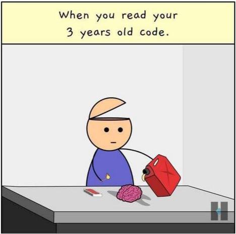{.fragment fragment-index=1 fig-alt="Cómic: al leer tu código de hace 3 años, el personaje saca su cerebro para prenderle fuego" width="100%"}
:::
:::

::: {.notes}
(1:00) Reproducibilidad computacional: que otra persona ejecute nuestro código y obtenga los mismos resultados. Esa "otra persona" puede ser alguien de otra institución, un colaborador... y casi siempre, nosotros mismos dentro de unos años.
Clic: el cómic. Risa.
Clic: cómo lo resuelve el paquete. Cada objeto se regenera con los scripts de data-raw/, hay checkpoints entre lecciones para no empezar de cero, las versiones de las herramientas están fijas (g:Profiler e113) y cada versión del paquete tiene DOI en Zenodo.
Va dirigido a estudiantes y docentes de bioinformática, inmunología y ciencias biomédicas. La idea: que cualquiera reproduzca las figuras del artículo, paso a paso, en español o en inglés.
:::

## Tolerancia inmunológica en el lupus {.centrado}

::: {.etiqueta .azul .medio}
**Pregunta del estudio:** ¿está alterada la capacidad **tolerogénica** (antiinflamatoria) de las células dendríticas en mujeres con lupus?
:::

::: {.columns}
::: {.column width="40%"}
```{=html}
<div class="dif">
  <div class="cel mono">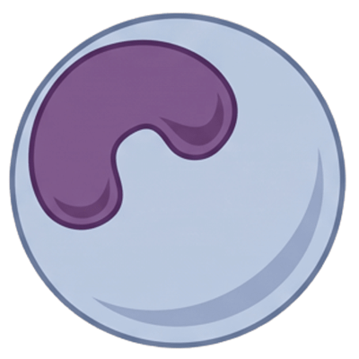<span class="nombre">Monocito</span></div>
  <div class="flecha">GM-CSF + IL-4<br><b>→</b></div>
  <div class="cel">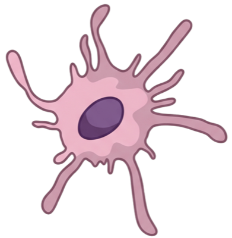<span class="nombre rosa">moDC</span></div>
  <div class="flecha">GM-CSF + IL-4<br>+ IL-10<br><b>→</b></div>
  <div class="cel">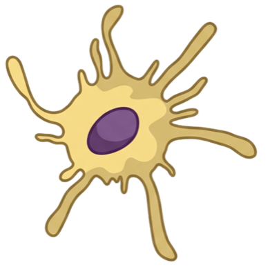<span class="nombre amarilla">tolDC</span></div>
</div>
```

::: {.pequeno}
**moDC:** dendrítica derivada de monocito<br>**tolDC:** dendrítica tolerogénica
:::
:::

::: {.column width="60%"}
::: {.cifras}
::: {.cifra}
[33]{.n}
[mujeres mexicanas<br>10 controles · 23 con lupus]{.t}
:::
::: {.cifra}
[99]{.n}
[transcriptomas<br>de RNA-seq]{.t}
:::
::: {.cifra}
[3]{.n}
[tipos celulares<br>monocito · moDC · tolDC]{.t}
:::
::: {.cifra}
[94]{.n}
[genes diferencialmente<br>expresados en lupus]{.t}
:::
::: {.cifra}
[32]{.n}
[genes estimulados<br>por interferón (ISG)]{.t}
:::
::: {.cifra .destacada}
[7]{.n}
[lecciones que reproducen<br>las figuras del artículo]{.t}
:::
:::
:::
:::

::: {.pequeno .fuente}
Datos del artículo [Hernández-Ledesma, Coss-Navarrete *et al.* (2026) *Front. Immunol.* 17:1771959](https://doi.org/10.3389/fimmu.2026.1771959)
:::

::: {.notes}
(1:15) Primero la pregunta: ¿está alterada la capacidad tolerogénica de las células dendríticas en las pacientes? Las tolDC producen señales antiinflamatorias (como IL-10) e inducen tolerancia inmunológica; en el lupus, esa tolerancia se pierde.
Explicar la diferenciación in vitro: a partir de monocitos se obtienen moDC (GM-CSF + IL-4) y tolDC (GM-CSF + IL-4 + IL-10).
Recorrer las cifras de izquierda a derecha. Rematar con el 7: las lecciones son el corazón del paquete.
:::

## Instálalo en 10 segundos ⚡

```r
# install.packages("remotes")
remotes::install_github("EveliaCoss/GeneExprLupusMx", build_vignettes = TRUE)
BiocManager::install(c("DESeq2", "ComplexHeatmap"))  # para algunas lecciones

library(GeneExprLupusMx)
filtered_txi <- download_data("filtered_txi")        # solo descarga la primera vez
dim(filtered_txi$counts)                             # genes x muestras
#> [1] 21718    99
```

::: {.medio}
**Objetos listos para usar en R**

| | | | |
|---|---|---|---|
| `filtered_txi` ⬇️ | Cuentas de RNA-seq | `dds` ⬇️ | Objeto de DESeq2 |
| `metadata_cleaned` | Metadatos de las muestras | `de_results` | Genes diferenciales |
| `volunteer_info` | Datos clínicos | `go_results` | Enriquecimiento funcional |
| `isg_genes` | Genes estimulados por interferón | `tolDC_genes` | Firma de las tolDC |

⬇️ Se descargan con `download_data()` · [Descarga de datos](https://eveliacoss.github.io/GeneExprLupusMx/articles/download_es.html){.boton}
:::

::: {.pequeno .fuente}
Datos del artículo [Hernández-Ledesma, Coss-Navarrete *et al.* (2026) *Front. Immunol.* 17:1771959](https://doi.org/10.3389/fimmu.2026.1771959)
:::

::: {.notes}
(1:15) Dos líneas y ya tienes 99 transcriptomas en tu sesión.
El paquete es ligero: los tres objetos más grandes (filtered_txi, dds, zscore_mat) se descargan con download_data() la primera vez y luego se leen de tu computadora.
No hace falta correr DESeq2 para empezar: los resultados intermedios (de_results, go_results...) ya vienen en el paquete.
:::

## Del FASTQ al hallazgo, en una sola imagen {.centrado}

[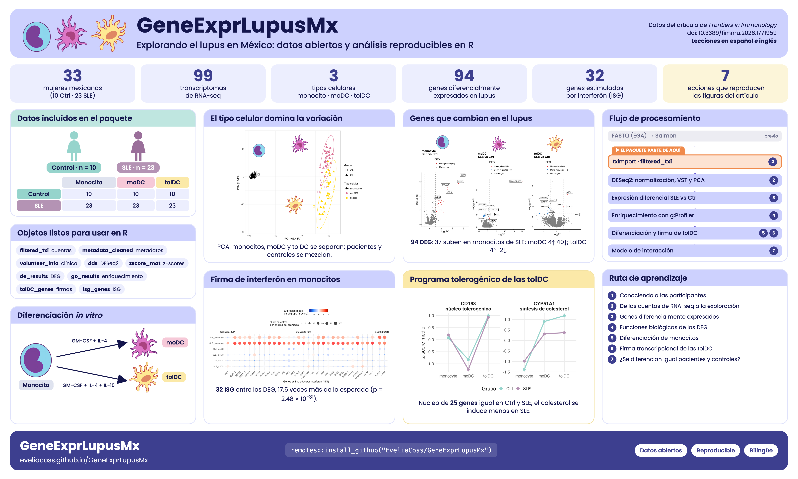{fig-alt="Infografía de GeneExprLupusMx: datos, flujo de análisis, hallazgos y lecciones" width="88%"}](https://eveliacoss.github.io/GeneExprLupusMx/)

::: {.notes}
(0:45) Señalar: datos a la izquierda, hallazgos al centro, flujo de procesamiento y ruta de aprendizaje a la derecha.
:::

## 7 lecciones, paso a paso 📚

::: {.columns}
::: {.column width="60%"}
1. [Conociendo a las participantes](https://eveliacoss.github.io/GeneExprLupusMx/articles/clinical_es.html)
2. [De las cuentas de RNA-seq a la exploración](https://eveliacoss.github.io/GeneExprLupusMx/articles/intro_RNAseq_es.html)
3. [Genes diferencialmente expresados](https://eveliacoss.github.io/GeneExprLupusMx/articles/l3_DEGs_es.html)
4. [Funciones biológicas de los DEG](https://eveliacoss.github.io/GeneExprLupusMx/articles/l4_GOterms_es.html)
5. [Diferenciación de monocitos](https://eveliacoss.github.io/GeneExprLupusMx/articles/l5_DEGs_monocytes_diff_es.html)
6. [La firma de las tolDC](https://eveliacoss.github.io/GeneExprLupusMx/articles/l6_DEGs_tolDcs_es.html)
7. [¿Se diferencian igual pacientes y controles?](https://eveliacoss.github.io/GeneExprLupusMx/articles/l7_DEGs_between_groups_es.html)
:::

::: {.column width="40%"}
[🇲🇽 Empieza aquí](https://eveliacoss.github.io/GeneExprLupusMx/articles/intro_es.html){.boton}

[🇺🇸 Start here](https://eveliacoss.github.io/GeneExprLupusMx/articles/intro_en.html){.boton}

::: {.qr data-url="https://eveliacoss.github.io/GeneExprLupusMx/"}
:::

::: {.etiqueta .pequeno}
Cada lección **reproduce una figura del artículo**, paso a paso y con explicación biológica.
:::
:::
:::

::: {.notes}
(1:15) Cada lección se apoya en la anterior: estadística descriptiva → PCA → DESeq2 → g:Profiler → modelos con interacción.
:::

## ✅ Al terminar la ruta... {.centrado}

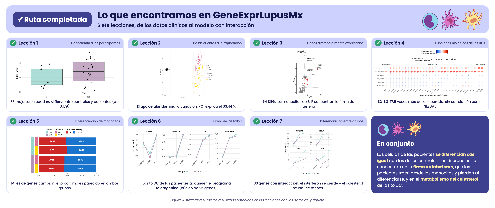{fig-alt="Resumen de los resultados de las 7 lecciones" width="92%"}

::: {.fragment .etiqueta .azul .medio}
**Conclusión:** pacientes y controles se diferencian de forma similar; las diferencias están en la **firma de interferón** de los monocitos y en la **síntesis de colesterol** de las tolDC.
:::

::: {.notes}
(0:45) El mensaje biológico final que se obtiene completando la ruta: la diferenciación es parecida en pacientes y controles; lo que cambia es la firma de interferón (que las pacientes traen desde los monocitos y se pierde al diferenciarse) y el metabolismo del colesterol en las tolDC, que se induce menos en lupus. Ciencia real, reproducida por quien aprende.
:::

## ¿Y si no programas en R? 🤷🏽‍♀️ {background-color="#3D3F8F" .oscura}

::: {.columns}
::: {.column width="45%"}
[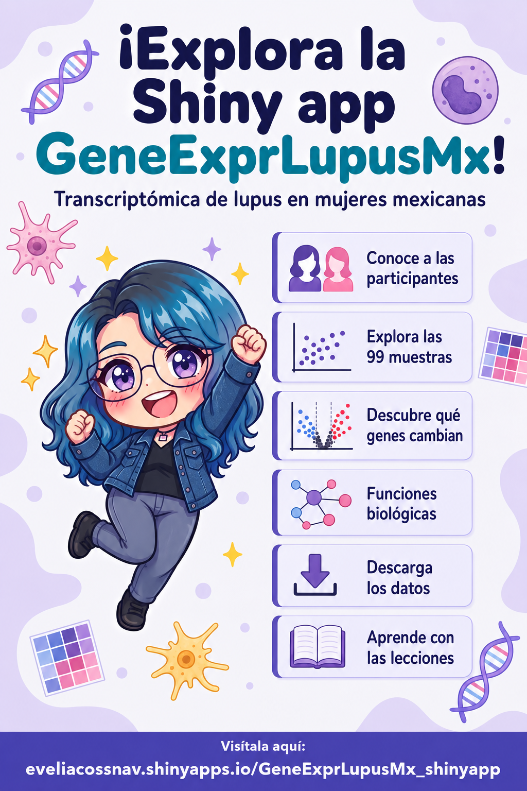{fig-alt="Póster: ¡Explora la Shiny app GeneExprLupusMx!" width="70%"}](https://eveliacossnav.shinyapps.io/GeneExprLupusMx_shinyapp/)
:::

::: {.column width="55%"}
### ¡Explora la Shiny app! ✨

Los mismos datos, **sin escribir una línea de código**.

<br>

[▶ Abrir la app](https://eveliacossnav.shinyapps.io/GeneExprLupusMx_shinyapp/){.boton .amarillo}

::: {.qr data-url="https://eveliacossnav.shinyapps.io/GeneExprLupusMx_shinyapp/"}
:::
:::
:::

::: {.notes}
(0:45) Pensada para estudiantes de biomedicina, médicas, médicos y público curioso. Invitar a escanear el QR ya.
:::

## ¿Qué puedes hacer en la app?

::: {.columns}
::: {.column width="42%" .medio}
- **Participantes:** edad, diagnóstico, tratamiento
- **Exploración:** PCA, expresión de un gen, *heatmaps*
- **Expresión diferencial:** 9 comparaciones, *volcano plots*
- **Funciones biológicas:** *Manhattan* y *dot plots*
- **Descargas:** tablas en CSV y figuras en PNG
- **Aprende:** cada gráfica enlaza a su lección

{.chibi fig-alt="Chibi de Evelia leyendo un libro" width="55%"}
:::

::: {.column width="58%"}
[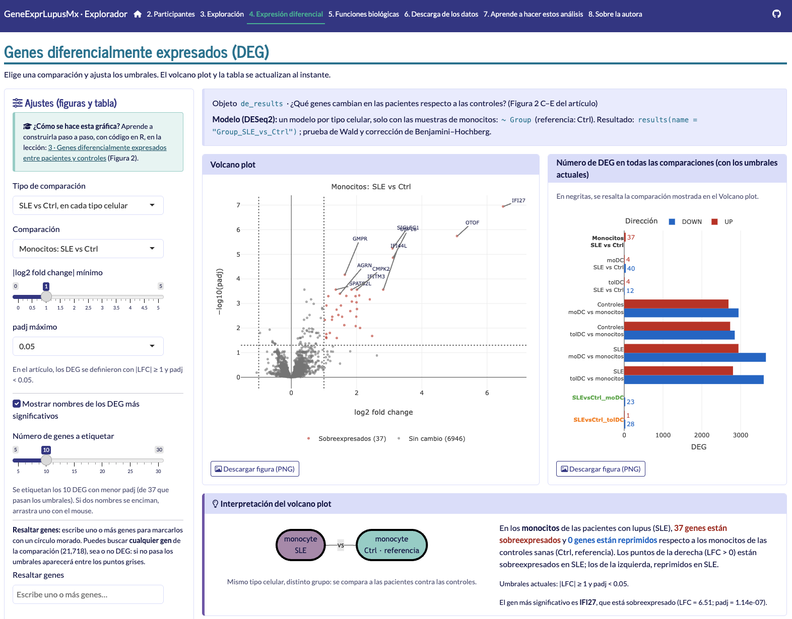{.captura fig-alt="Captura de la sección de expresión diferencial de la app: volcano plot y número de DEG por comparación" width="100%"}](https://eveliacossnav.shinyapps.io/GeneExprLupusMx_shinyapp/)
:::
:::

::: {.notes}
(0:45) El puente clave: cada gráfica de la app enlaza a la lección que enseña a construirla en R. La app es la puerta de entrada al paquete.
:::

## Ciencia abierta, de verdad 🔓

::: {.columns}
::: {.column width="50%"}
**📦 Paquete**

- Licencia MIT
- [DOI 10.5281/zenodo.23751369](https://doi.org/10.5281/zenodo.23751369)
- [Código en GitHub](https://github.com/EveliaCoss/GeneExprLupusMx)
- Siguiendo las guías de [rOpenSci](https://ropensci.org/)
:::

::: {.column width="50%"}
**✨ Shiny app**

- Licencia MIT
- [DOI 10.5281/zenodo.23751397](https://doi.org/10.5281/zenodo.23751397)
- [Código en GitHub](https://github.com/EveliaCoss/GeneExprLupusMx_shinyapp)
- Datos en [Zenodo](https://doi.org/10.5281/zenodo.17742206) con licencia CC BY 4.0
- Por ahora, solo en español 🇲🇽
:::
:::

::: {.etiqueta .azul .centrado .medio .abajo}
**Principios FAIR:** *«Tan abiertos como sea posible, tan cerrados como sea necesario»*<br>
[Abiertos por defecto: los datos procesados son públicos; los FASTQ, con acceso controlado en EGA]{.pequeno}
:::

::: {.notes}
(0:45) Todo citable y reutilizable. Recordar citar el paquete y también los datos (artículo + Zenodo).
FAIR: datos localizables, accesibles, interoperables y reutilizables. El lema "tan abiertos como sea posible, tan cerrados como sea necesario" (Comisión Europea, Horizonte 2020) resume el equilibrio: abrir por defecto, pero proteger a las participantes. Aquí: los datos procesados están abiertos en Zenodo y en el paquete; los datos crudos de secuenciación (FASTQ) están en EGA con acceso controlado.
:::

## ¿Cómo puedes sumarte? 🙌 {.centrado}

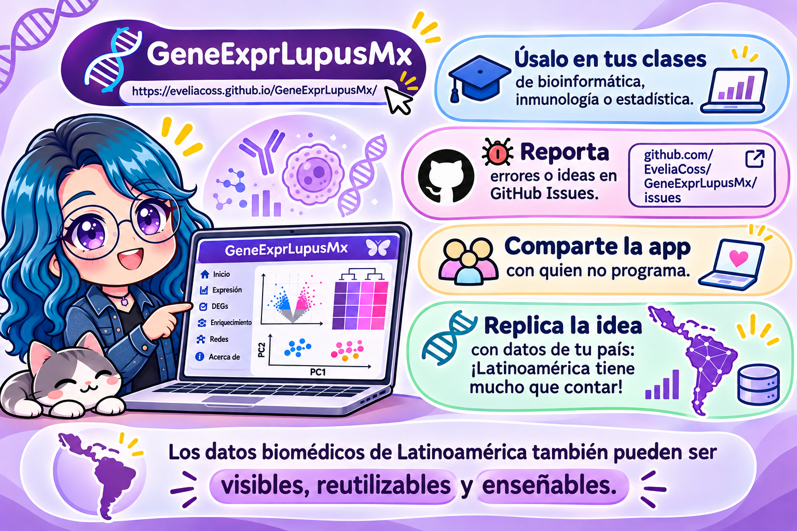{fig-alt="Ilustración: úsalo en tus clases, reporta errores o ideas en GitHub Issues, comparte la app con quien no programa y replica la idea con datos de tu país. Los datos biomédicos de Latinoamérica también pueden ser visibles, reutilizables y enseñables." width="80%"}

::: {.notes}
(0:45) Llamado a la acción. El mensaje que quiero que se lleven: hagamos paquetes de datos de nuestra región.
:::

## ¡Gracias! 💜 {background-color="#3D3F8F" .oscura .centrado}

::: {.columns}
::: {.column width="30%"}
{fig-alt="Chibi de Evelia abrazando un corazón" width="100%"}

::: {.medio}
**Evelia Coss**<br>[eveliacoss.github.io](https://eveliacoss.github.io/)
:::
:::

::: {.column width="35%"}
**📦 Paquete**

::: {.qr data-url="https://eveliacoss.github.io/GeneExprLupusMx/"}
:::

[eveliacoss.github.io/GeneExprLupusMx](https://eveliacoss.github.io/GeneExprLupusMx/){.pequeno}
:::

::: {.column width="35%"}
**✨ Shiny app**

::: {.qr data-url="https://eveliacossnav.shinyapps.io/GeneExprLupusMx_shinyapp/"}
:::

[eveliacossnav.shinyapps.io/<br>GeneExprLupusMx_shinyapp](https://eveliacossnav.shinyapps.io/GeneExprLupusMx_shinyapp/){.pequeno}
:::
:::

<br>

::: {.medio}
Gracias a las voluntarias del estudio, a [rOpenSci](https://ropensci.org/)<br>y al equipo de [Hernández-Ledesma, Coss-Navarrete *et al.* (2026)](https://doi.org/10.3389/fimmu.2026.1771959)<br>por dejar públicos sus datos en [Zenodo](https://doi.org/10.5281/zenodo.17742206) bajo licencia **CC&nbsp;BY&nbsp;4.0**.
:::

::: {.notes}
(0:30) Agradecer a las voluntarias y al equipo del artículo, que publicó sus datos y análisis en Zenodo con licencia CC BY 4.0: gracias a eso este paquete existe. Dejar esta diapositiva durante las preguntas.
:::
